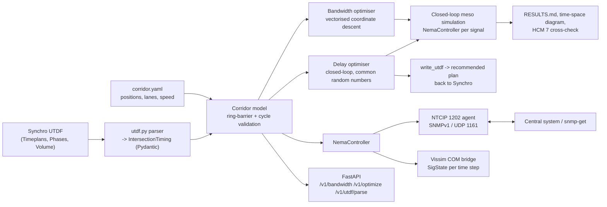
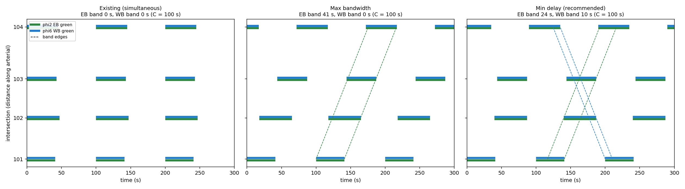

# synchro-vissim-ntcip-controller

**From a Synchro timing sheet to a running controller.** Parses Synchro UTDF files into
typed NEMA TS2 dual-ring timing, emulates an actuated-coordinated controller
(force-offs, gap-out, max-out, barrier hold, dual entry, call memory, early return), optimises
corridor offsets two ways (bandwidth and simulated delay), evaluates them in closed loop,
writes the result back to UTDF, and exposes each controller over **NTCIP 1202 / SNMPv1**.
A Vissim COM bridge drives Vissim signal groups from the same controller code.

**Headline (4-signal arterial, C = 100 s, 10 seeds, 1 h each):** delay-optimised offsets cut
all-movement delay **20%** (25.8 → 20.6 s/veh, p < 0.001) versus the existing simultaneous plan.
The textbook max-bandwidth plan produced a 41-s one-way green wave that **raised westbound
delay 60%**. The emulated controller runs at **5.9 µs per 0.1-s tick**, and NTCIP status polls
return in **0.41 ms p50 / 3.1 ms p99** over loopback UDP.

---

## 1. Problem formulation

A retiming project is usually split across tools: Synchro (HCM capacity, splits, offsets),
Vissim (operations), and the field controller (NTCIP). Each hand-off is a source of error:
wrong reference phase, sequence or force-off mode. This repository puts all three in
one tested code path:

| Concern | Here |
|---|---|
| **Traffic engineering** | UTDF import/export, ring-barrier validation, HCM 7 lane-group delay and LOS, MAXBAND-style bandwidth, delay-based offset optimisation, closed-loop evaluation |
| **ML / optimisation** | Simulation-based coordinate descent with common random numbers, separate tuning and evaluation seeds (no overfitting to the test seeds), paired significance tests |
| **Systems** | Tick-based controller state machine (5.9 µs/tick), dependency-free BER/SNMP codec, asyncio UDP agent, FastAPI progression service, Docker Compose with one agent container per intersection |

**Study corridor.** "Main Street": four signals at 0, 420, 820 and 1,350 m, 40 mph progression
speed, two arterial through lanes, lead-lead protected lefts, common C = 100 s. The existing
Synchro-style timing has all offsets at 0 (a simultaneous system, common in outdated plans).
Volumes: arterial through 930–1,050 vph per direction, side streets 240–320 vph, lefts 60–100 vph.

> Provenance: the UTDF file in `examples/` was written for this study. It follows Synchro's
> documented combined-UTDF record layout, but no Synchro licence was available to round-trip it
> through Synchro itself. The Vissim bridge is likewise untested without a Vissim licence. All
> results come from the bundled closed-loop mesoscopic model.

---

## 2. Architecture



---

## 3. Methodology

### 3.1 Controller (NEMA TS2, `nema/controller.py`)

Local cycle time is referenced to the begin of green of the coordinated phases 2+6
(Synchro "Referenced to: Begin of Green", reference phase 206):

$$t_c = (t - \text{offset}) \bmod C$$

Each phase has a **fixed force-off** at the end of its nominal green, $FO_p$. A non-coordinated phase:

* starts only if it has a call (with locking detector memory) and its permissive window is open:
  $g_{\min,p} \le (FO_p - t_c) \bmod C \le (FO_p - t_{yield}) \bmod C$;
* terminates on **gap-out** (passage timer $\ge$ vehicle extension after min green), **max-out**, or
  **force-off**, whichever comes first.

The coordinated phases rest in green and yield at their force-off only if a conflicting call
exists, so time not used by side streets returns to the arterial (**early return**).
**Barrier rule:** the two rings cross a barrier together. A ring that finishes early holds its last
phase green. If a ring has no demand in a barrier group, its through phase is served by **dual entry**.

Safety is property-tested: under 3,000 s of random calls, no barrier-A and barrier-B phases are
ever non-red at the same time, and no ring shows two phases.

### 3.2 Bandwidth

A vehicle entering the first signal eastbound at $\tau$ arrives at signal $k$ at $\tau + x_k/v$. It is in the band if

$$\big(\tau + x_k/v - \text{offset}_k\big) \bmod C \in [s_{2,k},\, e_{2,k}) \quad \forall k,$$

and the EB bandwidth is the measure of such $\tau$ (westbound uses phase 6). The optimiser
maximises $b_{EB}+b_{WB}-0.05\,|b_{EB}-b_{WB}|$ by coordinate descent over a 1-s offset grid.
Each update scores all 100 candidates for one signal as one boolean array operation, with 25
starts in total; the whole corridor optimises in 1.6 s.

### 3.3 Delay-based offset optimisation

Bandwidth ignores volumes and queues. The delay optimiser instead minimises the total
stop-line delay (veh·h) from the closed-loop simulation, by coordinate descent on a 5-s grid
starting from the bandwidth solution. Every candidate is scored on the same two **tuning**
seeds (common random numbers). The study then **evaluates** on ten different seeds.

### 3.4 Closed-loop mesoscopic model (`corridor/meso.py`)

Each lane group is a FIFO vertical queue that discharges at $3600/(s\cdot N)$ s/veh during the
effective green: from 2 s after onset (start-up lost time, waived for vehicles that arrive
moving) until 2 s into yellow. Queue presence places a detector call, and each arrival is an
actuation. Arterial vehicles leave one stop line and reach the next after $d/v$, so platoons and
offsets interact. Delay is stop-line queue delay, which is a lower bound on control delay.

### 3.5 HCM 7 cross-check

$$d = d_1\,PF + d_2,\quad d_1=\frac{0.5\,C\,(1-g/C)^2}{1-\min(1,X)\,g/C},\quad PF=\frac{1-P}{1-g/C},\quad
d_2 = 900T\Big[(X-1)+\sqrt{(X-1)^2+\tfrac{8kIX}{cT}}\Big]$$

using the simulated average green and share of arrivals on green ($P$).

---

## 4. Results

Full report: [`results/main_street/RESULTS.md`](results/main_street/RESULTS.md). All plans are
actuated-coordinated unless noted. Results are mean ± 95% CI over 10 seeds (1 h after a
5-min warm-up), with paired t-tests against the existing plan (common random numbers).

### 4.1 Offsets and bandwidth

| Plan | Offsets 101/102/103/104 (s) | EB band | WB band |
|---|---|---|---|
| Existing (simultaneous) | 0 / 0 / 0 / 0 | 0 s | 0 s |
| Max bandwidth | 0 / 18 / 44 / 72 | **41 s** | 0 s |
| Min delay (recommended) | 0 / 40 / 44 / 90 | 24 s | 10 s |



### 4.2 Operations

| Metric | Existing | Max bandwidth | **Min delay** | Min delay, pretimed |
|---|---|---|---|---|
| EB delay per trip (s) | 80.2 ± 1.6 | 22.4 (−72%) | 35.0 (−56%) | 55.0 (−32%) |
| WB delay per trip (s) | 70.6 ± 1.2 | 113.1 (**+60%**) | 58.2 (−18%) | 72.8 (+3%) |
| EB / WB stops per trip | 2.18 / 2.04 | 1.02 / 3.03 | 2.03 / 2.60 | 2.58 / 2.93 |
| Arterial arrivals on green | 0.53 | 0.59 | **0.66** | 0.56 |
| Side-street delay (s/veh) | 40.3 | 40.6 (n.s.) | 40.6 (n.s.) | 36.4 (−10%) |
| **All-movement delay (s/veh)** | 25.8 ± 0.4 | 24.0 (−7%) | **20.6 (−20%)** | 22.7 (−12%) |

All changes are significant at p < 0.001 except where marked n.s. (side-street, p ≈ 0.47) and
the pretimed WB change (p = 0.043).

**Engineering reading.**

* **Bandwidth is not delay.** With spacings of 420/400/530 m, travel times of 23/22/30 s and C = 100 s,
  this arterial cannot carry a wide two-way band. The bandwidth objective therefore spends everything
  on one direction (41 s EB, 0 s WB), and westbound delay rises 60%.
* **Minimising delay balances the corridor.** It gives up 17 s of EB band but buys a 10-s WB band,
  lowers delay in both directions, and lifts arrivals on green from 53% to 66%. WB stops still rise
  (2.04 → 2.60) even though WB delay falls. That trade-off should be shown to the agency.
* **Actuation is worth about 2 s/veh here.** With the same offsets, pretimed control loses early
  return: the arterial gets less green and side streets get more.

### 4.3 HCM 7 vs. simulation (recommended plan)

On coordinated phases, HCM delay (using simulated green and arrivals on green) and simulated delay
agree within 0.0–1.8 s, for example 22.1 vs 21.0 s and 3.6 vs 1.8 s. On side streets, HCM is 8–15 s
higher, as expected: the simulation excludes acceleration/deceleration delay, and HCM's $d_2$ adds
random-arrival overflow. The full table is in `RESULTS.md`.

### 4.4 Systems performance (Windows laptop, i5-1135G7, Python 3.12)

| Operation | Result |
|---|---|
| Controller tick (actuated, 8 phases) | 5.9 µs |
| Bandwidth optimisation, 4 signals, 25 starts | 1.6 s |
| Delay optimisation | 119 closed-loop evaluations (2 seeds × 1,500 s simulated each) |
| SNMP GET, 3 varbinds, loopback (n = 2,000) | p50 0.41 ms, p95 1.0 ms, p99 3.1 ms |

---

## 5. NTCIP 1202 agent

Objects served (asc node 1.3.6.1.4.1.1206.4.2.1): `phaseMinimumGreen`, `phasePassage`,
`phaseMaximum1`, `phaseYellowChange`, `phaseRedClear` (read-write, validated against
ring-barrier rules; an illegal value returns `badValue`), and `phaseStatusGroupReds/Yellows/Greens`
(read-only bitmasks). GET, GETNEXT and SET are supported. The write community is required for SET,
and wrong-community requests are dropped, as SNMPv1 agents do.

```bash
ntcip-ctrl agent --int-id 101 --port 1161          # terminal 1
ntcip-ctrl snmp-get --port 1161 --polls 20         # terminal 2: live greens/yellows
```

Check the OID suffixes against the vendor MIB before connecting to real hardware.

---

## 6. Repository layout

```
src/ntcip_ctrl/
  timing/     models.py (Pydantic timing + validation), utdf.py, schedule.py, hcm.py, corridor_config.py
  nema/       controller.py (dual-ring actuated-coordinated state machine)
  corridor/   bandwidth.py, delay_opt.py, meso.py
  ntcip/      ber.py (ASN.1 BER), mib.py (NTCIP 1202 objects), agent.py (asyncio agent + client)
  vissim/     bridge.py (COM software-in-the-loop)
  services/   study.py, report.py
  api/        app.py (FastAPI)
  cli.py
configs/corridor.yaml, examples/main_street_existing.utdf.csv, results/main_street/, docker/
tests/        23 tests: controller timing and safety, UTDF round trip, bandwidth closed form, HCM, SNMP, API
```

## 7. Reproduce

```bash
python -m venv .venv && .venv/Scripts/activate        # Linux/macOS: source .venv/bin/activate
pip install -r requirements.txt && pip install --no-deps -e .
pytest
ntcip-ctrl parse-utdf examples/main_street_existing.utdf.csv
ntcip-ctrl optimize --write results/optimized.utdf.csv
ntcip-ctrl study --workers 2                           # optimisers + 4 plans x 10 seeds
docker compose -f docker/docker-compose.yml up --build # API :8000, agents udp/1161, udp/1162
```

## 8. Limitations

* Mesoscopic vertical queues: no spillback between signals, no lane changing, no turning flows
  feeding downstream links; right turns are dropped.
* Fixed force-off mode only (no floating force-offs or permissive-period tables); no
  pedestrian timing or transition/preemption logic.
* The UTDF reader covers the Timeplans, Phases and Volume records used here.

## License

MIT
