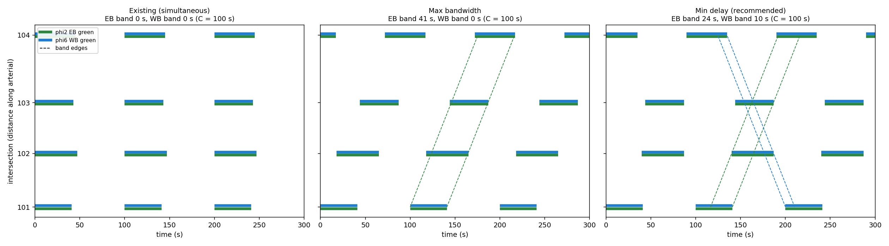

# Retiming study: `main_street`

Common cycle 100 s, progression speed 40 mph, seeds 11, 23, 37, 41, 59, 67, 73, 89, 97, 101 (common random numbers; paired t-tests vs. existing actuated-coordinated operation). 1 h analysis after 5 min warm-up.

## Progression bandwidth

| Plan | Offsets (s) | EB band | WB band | Efficiency |
|---|---|---|---|---|
| Existing (simultaneous) | 0, 0, 0, 0 | 0.0 s | 0.0 s | 0% |
| Max bandwidth (MAXBAND-style) | 0, 18, 44, 72 | 41.0 s | 0.0 s | 20% |
| Min total delay (simulation-based) | 0, 40, 44, 90 | 24.4 s | 10.4 s | 17% |

Delay optimiser: 119 closed-loop evaluations on tuning seeds 1001-1002 (disjoint from the evaluation seeds below).

## Operations (mean ± 95% CI over seeds)

| Metric | Existing (simultaneous), actuated-coord. | Max-bandwidth offsets, actuated-coord. | Min-delay offsets, actuated-coord. | Min-delay offsets, pretimed |
|---|---|---|---|---|
| EB arterial delay per trip (s) | 80.2 ± 1.6 | 22.4 ± 0.4 (-72%, p <0.001) | 35.0 ± 1.3 (-56%, p <0.001) | 55.0 ± 1.2 (-32%, p <0.001) |
| WB arterial delay per trip (s) | 70.6 ± 1.2 | 113.1 ± 2.1 (+60%, p <0.001) | 58.2 ± 1.9 (-18%, p <0.001) | 72.8 ± 1.6 (+3%, p 0.043) |
| EB stops per trip | 2.18 ± 0.03 | 1.02 ± 0.05 (-53%, p <0.001) | 2.03 ± 0.07 (-7%, p <0.001) | 2.58 ± 0.06 (+18%, p <0.001) |
| WB stops per trip | 2.04 ± 0.03 | 3.03 ± 0.03 (+49%, p <0.001) | 2.60 ± 0.04 (+27%, p <0.001) | 2.93 ± 0.02 (+44%, p <0.001) |
| Arterial arrivals on green (share) | 0.53 ± 0.00 | 0.59 ± 0.01 (+10%, p <0.001) | 0.66 ± 0.00 (+24%, p <0.001) | 0.56 ± 0.00 (+4%, p <0.001) |
| Side-street delay (s/veh) | 40.3 ± 0.7 | 40.6 ± 0.7 (+1%, p 0.467) | 40.6 ± 0.6 (+1%, p 0.465) | 36.4 ± 0.7 (-10%, p <0.001) |
| Arterial left-turn delay (s/veh) | 56.3 ± 2.4 | 57.7 ± 2.8 (+3%, p 0.015) | 57.3 ± 2.4 (+2%, p 0.036) | 54.9 ± 2.3 (-2%, p 0.024) |
| All-movement stop-line delay (s/veh) | 25.8 ± 0.4 | 24.0 ± 0.4 (-7%, p <0.001) | 20.6 ± 0.3 (-20%, p <0.001) | 22.7 ± 0.3 (-12%, p <0.001) |
| All-movement LOS (stop-line delay) | C | C | C | C |

## HCM 7 cross-check (min-delay offsets, actuated-coordinated)

HCM delay uses the simulated average green and, for coordinated phases, the simulated share of arrivals on green in the progression factor. Simulated delay is stop-line queue delay only (no acceleration/deceleration delay), so it should sit somewhat below HCM.

| Int | Phase | v (vph) | avg green (s) | v/c | P on green | HCM delay (LOS) | Sim delay |
|---|---|---|---|---|---|---|---|
| 101 | 2 | 1040 | 46.0 | 0.63 | 0.47 | 22.1 (C) | 21.0 |
| 101 | 6 | 920 | 46.5 | 0.55 | 0.56 | 17.0 (B) | 16.0 |
| 101 | 4 | 286 | 20.5 | 0.78 | 0.21 | 52.3 (D) | 41.5 |
| 101 | 8 | 276 | 21.4 | 0.72 | 0.23 | 47.5 (D) | 39.2 |
| 102 | 2 | 1050 | 61.3 | 0.48 | 0.73 | 8.0 (A) | 7.8 |
| 102 | 6 | 933 | 60.2 | 0.43 | 0.84 | 4.8 (A) | 4.3 |
| 102 | 4 | 234 | 19.3 | 0.67 | 0.20 | 47.5 (D) | 38.0 |
| 102 | 8 | 256 | 19.3 | 0.74 | 0.19 | 51.2 (D) | 39.0 |
| 103 | 2 | 1049 | 49.7 | 0.59 | 0.94 | 3.6 (A) | 1.8 |
| 103 | 6 | 936 | 50.0 | 0.52 | 0.30 | 24.6 (C) | 23.4 |
| 103 | 4 | 249 | 19.7 | 0.70 | 0.21 | 48.5 (D) | 39.2 |
| 103 | 8 | 282 | 19.3 | 0.81 | 0.20 | 56.8 (E) | 42.0 |
| 104 | 2 | 1046 | 54.8 | 0.53 | 0.87 | 5.1 (A) | 4.3 |
| 104 | 6 | 936 | 55.6 | 0.47 | 0.55 | 14.4 (B) | 14.4 |
| 104 | 4 | 321 | 23.2 | 0.77 | 0.23 | 48.7 (D) | 36.9 |
| 104 | 8 | 298 | 23.2 | 0.72 | 0.24 | 45.4 (D) | 35.4 |

